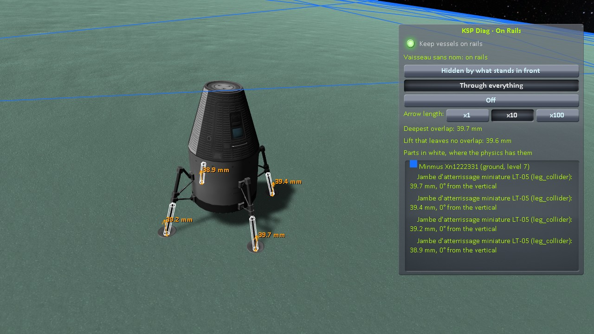
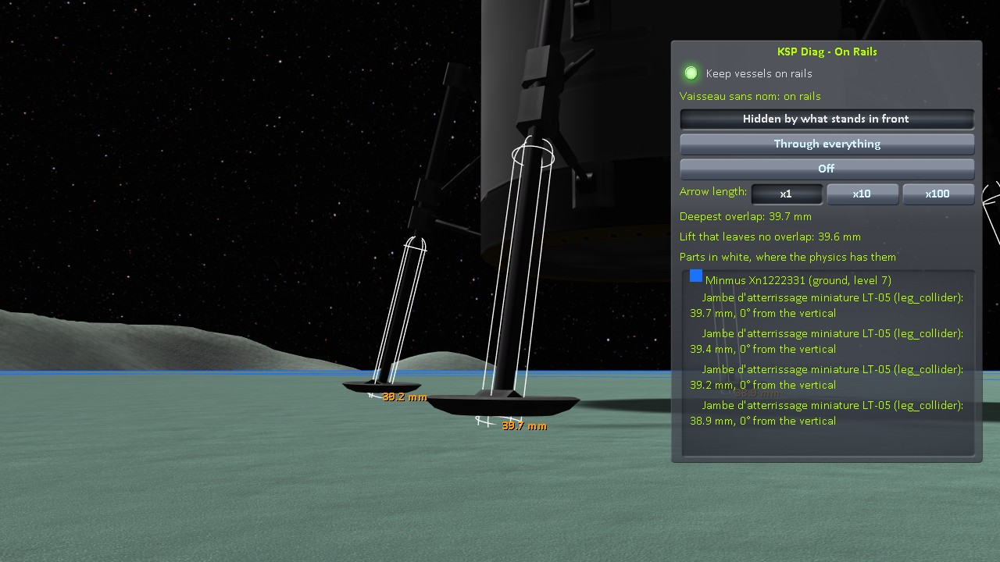

# KSP Diag - On Rails

**⚠️ Work in progress.** This is an active investigation, not a finished mod. The code and this page can still change, and several questions are still open.

A viewing instrument for KSP 1.12. A box of its window keeps every vessel on rails: tick it, load a save, and
the vessels stay where the game put them, physics never starting, until the box is unticked. Meanwhile, in
flight, the mod shows how far the colliders of the active vessel stand in the colliders around it — the
ground, a building, another vessel — as the physics measures it: the colliders stood in, the colliders of the
parts in them, drawn where the physics has them, and an arrow for each overlap, the way out and its depth. A
small window lists them by name, with their depth.

**How this was made.** Written with Claude, Anthropic's AI assistant, and reviewed line by line by a
human — me. I am saying so up front, because contributions made with an AI deserve a closer look than
others, and because some people would rather stop reading here. That look is easy to give here: the source
is under two thousand lines with no dependency of any kind. The mod reads the colliders the game already
holds, and changes only one thing, while its box is ticked: it asks the game to wait before taking vessels
off the rails, through the call the game makes itself when it switches vessels.

## What it shows

*KSP 1.12.5 with KSP Community Fixes: a small lander whose landing legs have very weak springs, settled on
a frozen lake of Minmus and saved, then the save loaded again with* Keep vessels on rails *ticked. Drawn
through everything, arrows ten times as long as the depth.*

**The colliders stood in.** Each collider that a part of the active vessel stands in is drawn as lines in a
colour of its own: the edges of a box, three circles for a sphere, the outline of a capsule, every edge of
the triangles of a mesh. A terrain quad is its own collider: stock gives it its mesh as collider, and the
whole quad is drawn.

**The parts in them.** The collider of each part that stands in another one is drawn in white, where the
physics has it. That is not always where the game draws the part: a landing leg puts its collider in one
place for the physics and draws its leg in another (see [When it measures](#when-it-measures)).

**An arrow per overlap.** For each collider of a part and each collider it stands in, the physics gives the
shortest move that takes the part's collider out, as a direction and a depth. The arrow starts at the point
of the part's collider furthest in, and points the way out. It is as long as the depth, or ten or a hundred
times as long, as chosen in the window. Its colour goes from yellow, for no depth, to red, for 10 cm and
more. The depth is written at its tip.

*The same lander, the camera at ground level, in the default mode, arrows as long as the depth: the pads
are drawn on the ice, the colliders of the legs reach below it.*

## Holding the vessels on rails

A vessel on rails has no physics: its parts do not move, and it stays where the game holds it, its saved
position for a vessel just loaded. The game takes a landed vessel off the rails 75 frames after loading it,
and a landed vessel that comes within 200 m of the active one (2 km in flight). Physics then starts at once,
and pushes apart whatever overlaps.

While *Keep vessels on rails* is ticked, the mod calls `OrbitPhysicsManager.HoldVesselUnpack` at every frame
and every physics step: the game then takes no vessel off the rails. Ticked before a save is loaded, it
holds the vessels of that save. Unticked, the game takes them off the rails a few physics steps later, as it
would have.

- A vessel already off the rails when the box is ticked stays so.
- The box is kept from one flight to the next, and when a save is loaded, until KSP is closed.
- Moving the active vessel through `FlightGlobals.SetVesselPosition` takes it off the rails all the same:
  that path does not ask whether vessels are held.

## When it measures

The mod measures right after a physics step, at most four times a second: where the physics has the
colliders, which is where it will have them at the next step. A part can move its colliders between
physics steps. A landing leg on rails puts its collider in one place for the physics step and in another,
several centimetres away, for the frame drawn. Measured at any other time, the reading would hang on whether
a physics step ran in that frame.

The drawing follows the vessel at every frame. The arrows and the white colliders keep the place they were
measured at, in the frame of the vessel: they do not follow a part that moves its collider for the frame
drawn.

## What it measures

- **The colliders of the active vessel**: every collider of its parts that is on, in an active object, and
  not a trigger. Wheel colliders are left out: the physics call below does not measure them.
- **Against what**: every collider on a layer that the physics lets collide with the part's, but for the
  parts of the active vessel itself. Triggers and wheel colliders are left out.
- **The depth and the way out** of each pair, through `Physics.ComputePenetration`, at the position and
  rotation the physics has for each. A pair the physics cannot measure, such as two meshes that are not
  convex, is not listed.
- **The lift that leaves no overlap**: how far the whole vessel would have to rise, along the vertical, for
  none of the overlaps listed to be left; measured by the same physics call, the vessel moved by halves
  between none and 20 m. Only the pairs already found count: a collider above the vessel that the lift
  would reach does not.

## The window

The window opens half way down the right edge of the screen and can be dragged. `Alt+F6` hides it, and
shows it again; the drawing goes on.

- ***Keep vessels on rails***, see [Holding the vessels on rails](#holding-the-vessels-on-rails).
- **The active vessel** and whether it is *on rails* or *off rails, physics running*.
- **Three modes.** *Hidden by what stands in front*, the default: a collider or an arrow below the ground
  does not show. *Through everything*: all drawn on top of the scene. *Off*.
- ***Arrow length***: *x1*, *x10*, the default, or *x100* the depth.
- ***Deepest overlap*** and ***Lift that leaves no overlap***, see [What it measures](#what-it-measures).
- **The list of the colliders stood in**, by the name of their parent and their own (a terrain quad by its
  own name, marked `(ground, level` *n*`)` with its subdivision level), each with a swatch of its colour and
  `(convex)` when the physics uses its hull. Under each, the parts in it, by their title and the name of
  their collider, with the depth and the angle of the way out from the vertical, the deepest first.

The box, the mode and the arrow length are kept from one flight to the next until KSP is closed. The mod
writes nothing to `KSP.log`, but an error if the shader it draws with cannot be found.

## What it draws as it is not

- **A convex `MeshCollider`** is drawn as its mesh, while the physics uses its convex hull. The list marks a
  collider stood in `(convex)`; the white colliders of the parts are not marked.
- **A mesh that scripts cannot read** is drawn as the box of its bounds, and its arrow starts at a corner
  of that box.
- **A sphere or a capsule under a scale that is not uniform** is drawn stretched, while the physics takes
  the largest scale.
- **The start of an arrow** is the vertex of the part's collider furthest against the way out, or the point
  of a box, sphere or capsule furthest that way: the deepest point of a flat contact is one of many.

## Taking a reading

Tick *Keep vessels on rails*, then bring a vessel into flight: load a save, for instance, switch to a vessel
of the tracking station, or come within 200 m of one. It stays on rails, and the window shows how it stands
in what is around it. Look around it with the camera; *Through everything* shows what the ground hides.
Untick the box to let physics start, and see what it makes of it.

Some situations change what a reading says. For instance:

- **The game can move a vessel as it takes it off the rails.** When it does, `KSP.log` says
  `ground contact! - error. Moving Vessel up` or `down`. The reading shows the vessel before that move.
- **A vessel resting on wheels** shows no overlap at its wheels: wheel colliders are not measured. The legs
  and the other colliders of a wheel part are.
- **A part can move on its own while the vessel is held**: a robotic part, for one. The reading follows it.
- **A part of another vessel within reach** is listed with the ground and the statics: held on rails too,
  it does not move either.

## Driving it by script

With [KSP-Util-MCPServer](https://github.com/lhervier/KSP-Util-MCPServer) installed next to it, this mod offers
its window to a program, as tools of that server: a script presses its buttons and reads what it shows,
as a player would. Without the server, this mod runs the same. To load a save while vessels are held, call
the server's `load_save` with `wait` set to `loaded`: by default it waits for physics to run on the active
vessel, which does not happen while the box is ticked.

| tool | what it does |
|---|---|
| `onrails_read` | reads what the window shows, without writing anything: whether vessels are kept on rails, the active vessel and whether it is on rails, the mode, the arrow length, the deepest overlap and the lift that leaves none, in mm, the colour of the colliders of the parts, and the list of the colliders stood in, each with its colour, whether it is convex, the level of its quad for the ground, and its overlaps: the part, its collider, the depth in mm and the angle from the vertical |
| `onrails_keep_on_rails` | ticks or unticks *Keep vessels on rails*, as clicking it does; works in any scene |
| `onrails_set_display` | chooses how the drawing is made, as the modes of the window do: `0` *Hidden by what stands in front*, `1` *Through everything*, `2` *Off* |
| `onrails_set_arrow_scale` | chooses how long the arrows are, as *x1*, *x10* and *x100* do: `1`, `10` or `100` |
| `onrails_move_window` | moves the window, as dragging it does: `x` and `y` in pixels from the top left corner of the screen; returns its position and size |
| `onrails_show_window` | shows or hides the window, as `Alt+F6` does; the drawing goes on either way |

## Get it

Either way you end up with the same `GameData/KSPDiagOnRails/` folder.

**Download it** — from the assets of the
[latest release](https://github.com/lhervier/KSP-Diag-OnRails/releases/latest).

**Or compile it** — clone this repository, set `KSPDIR` to your KSP install folder and run
`build.bat`. It needs the .NET SDK and
[KSP-Util-MCPServer](https://github.com/lhervier/KSP-Util-MCPServer) installed in that KSP, takes a few seconds,
reads the KSP assemblies straight from your install, and puts the DLL in
`GameData/KSPDiagOnRails/` inside the repository. It does not install anything.
KSP-Util-MCPServer is only needed to compile: it provides the attribute that marks what this mod offers to
it, and this mod runs the same without it. Worth doing if you would rather not run a binary you have no source for while
reporting what you saw.

## Install

Drop `GameData/KSPDiagOnRails` into the `GameData` of KSP, so that you end up with
`GameData/KSPDiagOnRails/KSPDiagOnRails.dll`. It runs on a stock install:
no Harmony, no ModuleManager, no dependency of any kind.

The window is there in every flight. Unticked, its box changes nothing; ticked, it only keeps vessels on
rails. Your saves are never touched. Removing the folder removes the mod.

## License

MIT
